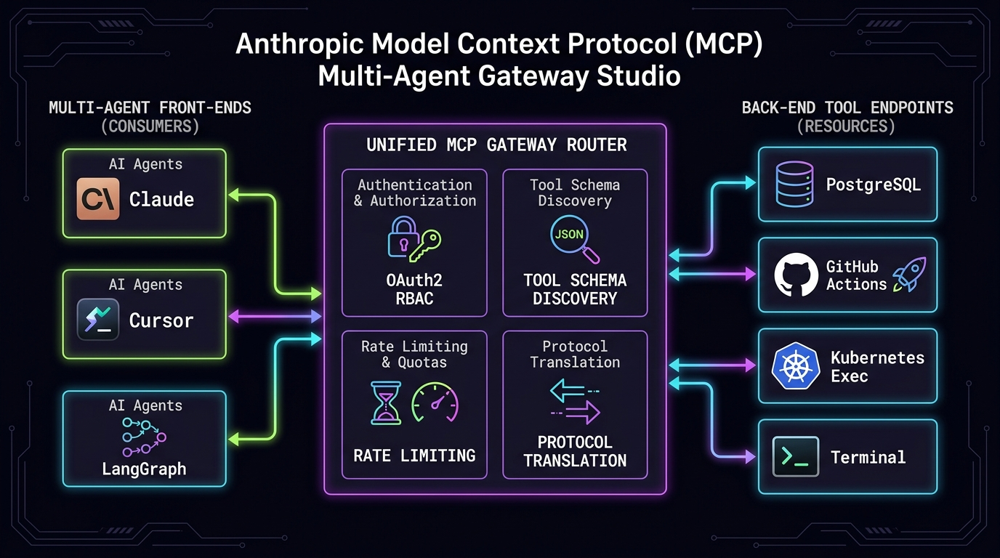

[](https://pradeeptalari.me/projects/)
[](https://pradeeptalari.me/tools/repo-learning/)

# Anthropic Model Context Protocol (MCP) Multi-Agent Gateway Studio

[](https://github.com/Pradeeptalari14/tp-mcp-agentic-bridge/actions)
[](LICENSE)
[](https://talaripradeep.info)

Production-grade **Universal Model Context Protocol (MCP) Gateway** providing dynamic tool discovery, OAuth2/RBAC tool filtering, and bi-directional SSE streaming across multi-agent systems.



## Key Technical Highlights
- **JSON-RPC 2.0 Multiplexing:** Routes asynchronous agent requests to heterogeneous backend tools (Postgres, GitHub, K8s, Bash) over unified Server-Sent Events (SSE).
- **Fine-Grained RBAC & Quotas:** Enforces per-agent call allowances, schema parameter sanitization, and execution authorization.
- **Dynamic Schema Discovery:** Agents discover real-time tool signatures in `<2ms` via centralized schema caching.
- **Audit Logging & Telemetry:** Full cryptographic audit trail of all agent tool invocations with Prometheus latency tracking.

## Quickstart
```bash
git clone https://github.com/Pradeeptalari14/tp-mcp-agentic-bridge.git
cd tp-mcp-agentic-bridge
bash scripts/validate.sh
```

---
*Synchronized with [Anthropic Model Context Protocol (MCP) Multi-Agent Gateway Studio Studio](https://pradeeptalari.me/tools/mcp-universal-gateway/) & [Repository Learning DAG](https://pradeeptalari.me/tools/repo-learning/) — [Talari Pradeep Portfolio](https://pradeeptalari.me)*
